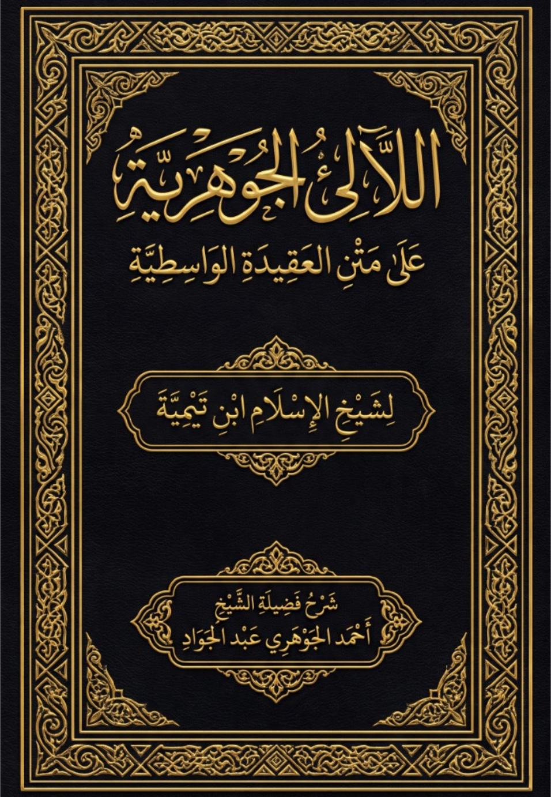
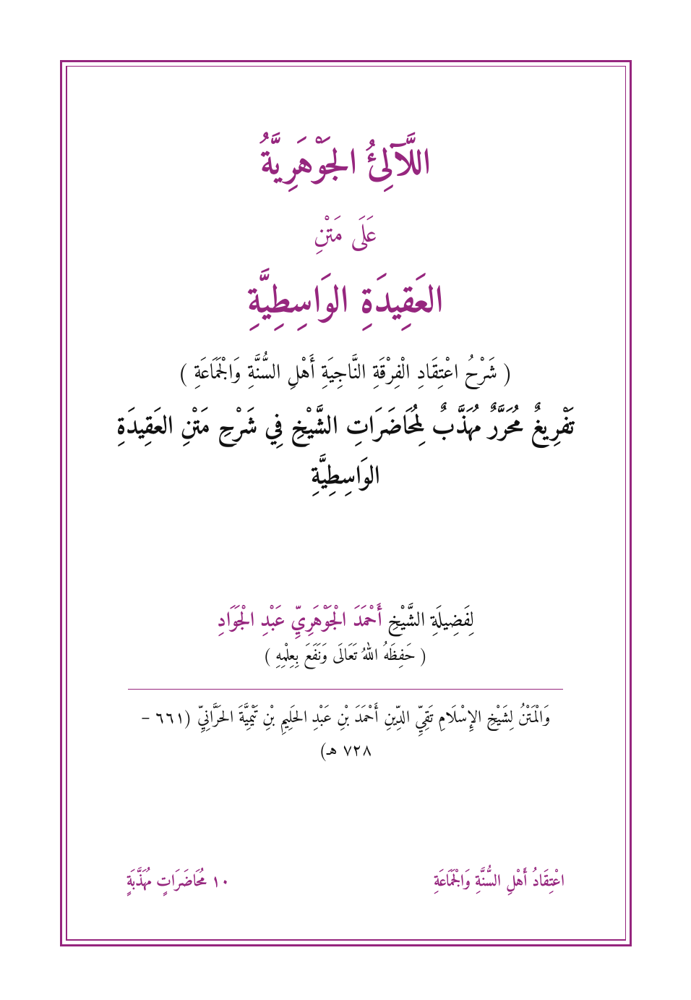
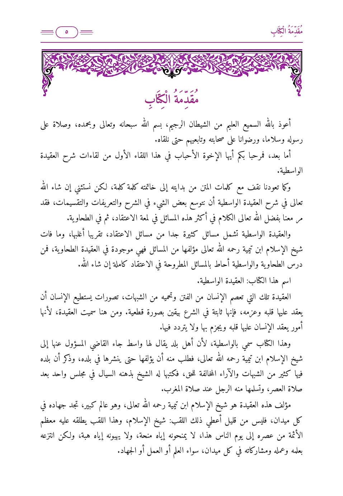
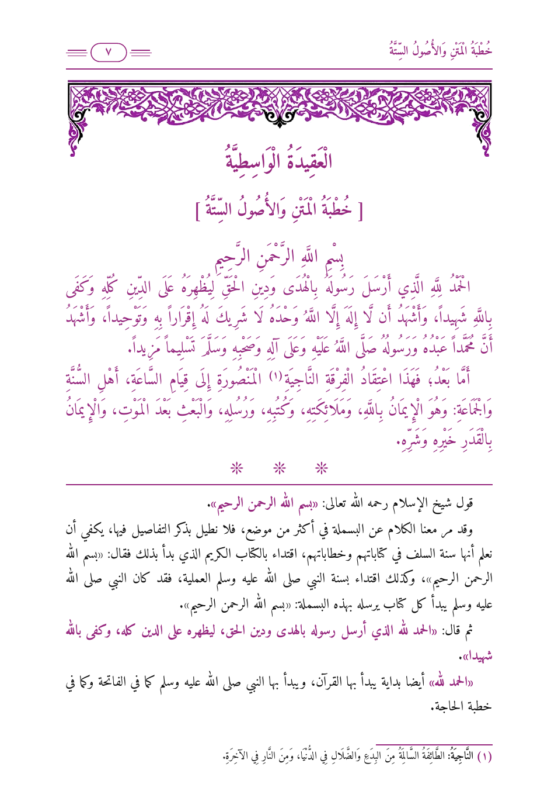
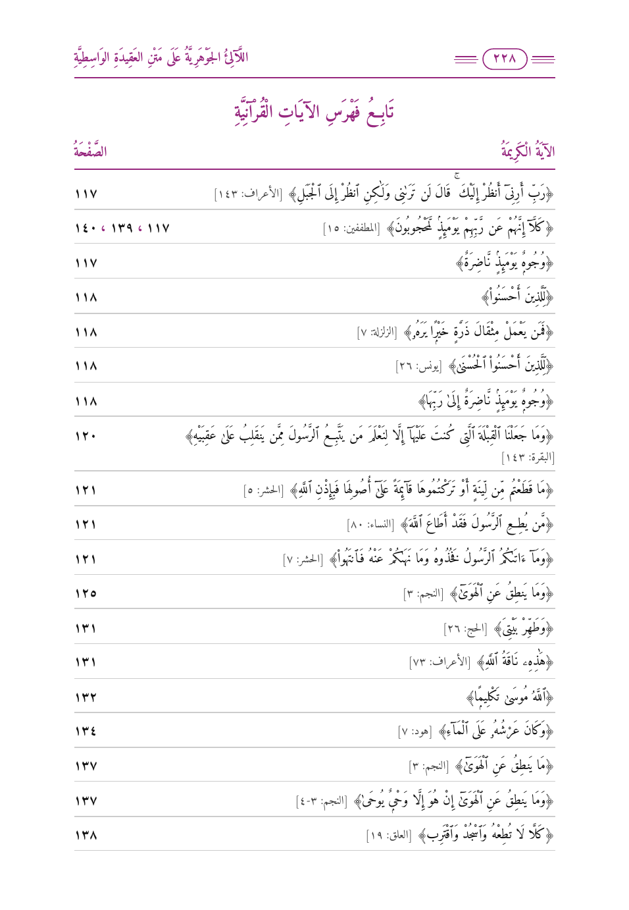
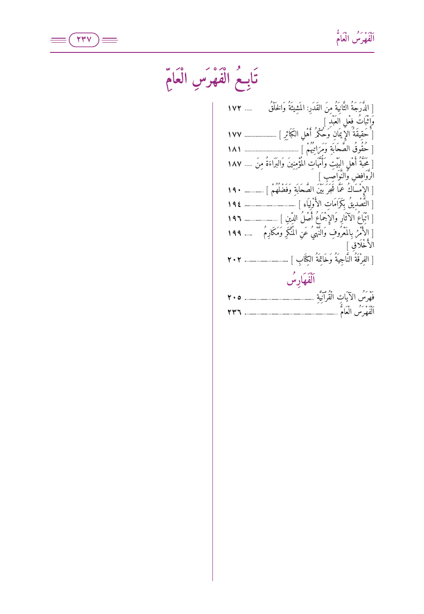

# اللَّآلِئُ الجَوْهَرِيَّةُ عَلَى مَتْنِ العَقِيدَةِ الوَاسِطِيَّةِ

**تفريغٌ علميٌّ موثَّقٌ ومضبوطٌ بالرسم العثماني وتشكيل المتن الكامل لشرح فضيلة الشيخ أحمد الجوهري عبد الجواد (حفظه الله تعالى) على متن «العقيدة الواسطية» لشيخ الإسلام تقي الدين أحمد بن عبد الحليم بن تيمية الحراني (٦٦١ – ٧٢٨ هـ).**

- **المصدر الصوتي الكامل:** [قائمة تشغيل شرح العقيدة الواسطية على يوتيوب (١٠ لقاءات علمية — ٦١٩ دقيقة، مع مجلس الإِسماع الحادي عشر)](https://youtube.com/playlist?list=PLjR2AWKLjP8T5pQ1SMr83qnNpgd4donq2&si=ck37P-rqP5cTKcv_)
- **الكتاب في Google Docs:**
  - [النسخة الحرفية الكاملة (Google Docs)](https://docs.google.com/document/d/1MGy30xH1_3rzgduW38JxIoQboWtp6R9HNGr8PTPDhEQ/edit)
  - [النسخة المحررة بألفاظ الشيخ (Google Docs)](https://docs.google.com/document/d/1-AOUDc_1XORvTy9XiDJgzZTYQ6O1Gq72SispS36Cu-4/edit)
- **تحميل الطبعات النهائية (PDF / DOCX / العارض التفاعلي / المحرر الحي):** [إصدارات المستودع Releases v1.0.0](https://github.com/ssssshyu53/al-laali-al-jawhariyyah-wasitiyyah/releases/tag/v1.0.0)

---

## نماذج من الإخراج الطباعي التراثي (`١٦٢ × ٢٣٤ ملم`)

| الغلاف | صفحة العنوان (لونين) | الافتتاحية والبسملة الخطية |
| :---: | :---: | :---: |
|  |  |  |

| المتن والشرح والحواشي (لونين `#96267e`) | فهرس الآيات القرآنية | الفهرس العام |
| :---: | :---: | :---: |
|  |  |  |

---

## أبرز المميزات العلمية والإخراجية

1. **التدقيق السمعي والالتزام التام بألفاظ الشيخ:**
   - مُطابَقَةً حرفية مع الصوت (`٩٩٫٣٪ – ١٠٠٫٧٪` احتفاظ في النسخة الحرفية عبر جميع اللقاءات العشرة).
   - في **النسخة المحررة** (`٩٥٫٢٪ – ٩٨٫٧٪` احتفاظ): أُبقيت ألفاظ الشيخ وعباراته دون اختصارٍ أو إبدالٍ، مع إبقاء افتتاحية اللقاء الأول وخاتمة اللقاء العاشر، وحذف مقدمات اللقاءات `٢–١٠` وخواتيم اللقاءات `١–٩`، وتنبيهات البث والتكرار اللفظي المتجاور فقط.
2. **ضبط متن «العقيدة الواسطية» الكامل من مصدر موثوق:**
   - مقارنة كلمةً بكلمة (`٥,١٦٢` كلمة متنية) وتشكيلٌ تام وتوزيعٌ محكمٌ على `٥٧` وحدةً دراسية دون سقطٍ أو تكرارٍ.
3. **الآيات القرآنية بالرسم العثماني وعزوها السُّوري:**
   - مطابقة كل آية مع المصحف (`quran-uthmani`) برسم خط `Amiri Quran` مع لصق موضع الآية `[السورة: الآية]` بخطٍّ أصغر لا ينقسم عبر السطور (`٩٢٣` موضعاً في الحرفية / `٩٠٩` في المحررة، بصفر أخطاء).
   - فهرسة الآيات في ختام الكتاب مرتبةً حسب ترتيب المصحف الشريف (`٥٣٢` آية مفهرسة في الحرفية، `٥٣٣` في المحررة).
4. **حواشي الغريب والمصطلحات العقدية:**
   - `٥٥` حاشيةً محررةً في `٣٨` وحدةً دراسية مستفادة من شروح الواسطية المعتمدة (الرشيد، ابن عثيمين، الفوزان) ومعاجم العربية، بترقيمٍ عربيٍّ مستقلٍّ لكل صفحة `(١)`.
5. **الإخراج المطبعي التراثي والمحرر التفاعلي (`Live Book Studio`):**
   - قطع الكتاب القياسي `١٦٢ × ٢٣٤ ملم` بنسختين لكل طبعة: **كلاسيكية أحادية اللون** (`#111111`) و**طبعة لونين** (أرجواني `#96267e` + `#111111`).
   - أداة تعديل وتوليد تفاعلية مدمجة في [viewer/editor.html](viewer/editor.html) تتيح تعديل النص، الصور، الغلاف، الفواصل، والألوان، ومعاينة الصفحات الحقيقية أو تصدير JSON وPDF مباشرةً.

---

## مواصفات الإصدارات المتوفرة

| الإصدار | المجلد / المسار | عدد الصفحات | كلمات الشرح | فهرس الآيات | الفهرس العام |
| :--- | :--- | :---: | :---: | :---: | :---: |
| **النسخة الحرفية الكاملة** (كلاسيكية & لونين) | [`اللَّآلِئُ_الجَوْهَرِيَّةُ_عَلَى_مَتْنِ_العَقِيدَةِ_الوَاسِطِيَّةِ/`](اللَّآلِئُ_الجَوْهَرِيَّةُ_عَلَى_مَتْنِ_العَقِيدَةِ_الوَاسِطِيَّةِ/) | **٢٤٢ صفحة** | **٤٩,٨٩٤ كلمة** | ص ٢١١–٢٤٠ | ص ٢٤١–٢٤٢ |
| **النسخة المحررة بألفاظ الشيخ** (كلاسيكية & لونين) | [`اللَّآلِئُ_الجَوْهَرِيَّةُ_عَلَى_مَتْنِ_العَقِيدَةِ_الوَاسِطِيَّةِ_النسخة_المحررة/`](اللَّآلِئُ_الجَوْهَرِيَّةُ_عَلَى_مَتْنِ_العَقِيدَةِ_الوَاسِطِيَّةِ_النسخة_المحررة/) | **٢٣٧ صفحة** | **٤٨,٤٣٦ كلمة** | ص ٢٠٥–٢٣٥ | ص ٢٣٦–٢٣٧ |
| **العارض التفاعلي (HTML)** | [`viewer/index.html`](viewer/index.html) & [`viewer/index_edited.html`](viewer/index_edited.html) | ٢٤٢ / ٢٣٧ | — | ✓ | ✓ |
| **استوديو المحرر المباشر (HTML)** | [`viewer/editor.html`](viewer/editor.html) | ٢٣٧ (قابلة للتعديل) | — | ✓ | ✓ |
| **التفريغ الصوتي الخام المجرد الموحد** | [`اللآلئ_الجوهرية_على_متن_العقيدة_الواسطية_تفريغ_كامل_مجرد.txt`](اللآلئ_الجوهرية_على_متن_العقيدة_الواسطية_تفريغ_كامل_مجرد.txt) | — | ١٠ لقاءات | — | — |

---

## جدول اللقاءات العشرة

| # | عنوان اللقاء | المدة | الوحدات | كلمات الحرفية | كلمات المحررة |
| :---: | :--- | :---: | :---: | :---: | :---: |
| ١ | مقدمة العقيدة الواسطية، والفرقة الناجية، وأصل الإيمان بالأسماء والصفات | ٧٣ د | ٥ | ٥,٥٣٩ | ٥,٤٢٩ |
| ٢ | سورة الإخلاص، وآية الكرسي، والأسماء والصفات، والعلم والحكمة | ٥٨ د | ٤ | ٤,٥١١ | ٤,٢٩٤ |
| ٣ | الصفات الذاتية والفعلية، والقدرة والقوة، والسمع والبصر، والمشيئة والمحبة والرحمة | ٦٤ د | ٧ | ٤,٩٣٢ | ٤,٧٧١ |
| ٤ | صفات الرضا والغضب، والإتيان والمجيء، والوجه واليدين والعينين، والسمع والبصر، والمكر والعزة | ٦١ د | ٦ | ٤,٣٠٩ | ٤,١٤٠ |
| ٥ | التنزيه الإجمالي والمفصل، نفي المثيل والشريك والولد، والاستواء على العرش، وعلو الله تعالى | ٥٥ د | ٥ | ٤,٥١٠ | ٤,٣٥٤ |
| ٦ | المعية العامة والخاصة، وإثبات صفة الكلام، وتنزيل القرآن غير مخلوق، والرؤية، وإثبات الصفات بالسنة | ٦١ د | ٦ | ٤,٦٥٧ | ٤,٥٢٦ |
| ٧ | أحاديث الصفات من السنة النبوية، وخاتمة فصل الأسماء والصفات، ومقدمة وسطية أهل السنة والجماعة | ٥٧ د | ٦ | ٥,٠٥٩ | ٤,٨٨١ |
| ٨ | وسطية أهل السنة في فرق الأمة، والعلو والمعية والقرب، والقرآن كلام الله، والرؤية، وفتنة القبر والبعث والموازين والدواوين | ٦٢ د | ٦ | ٥,٤١٢ | ٥,٢٨٢ |
| ٩ | الحوض والصراط والقنطرة، والشفاعات الثلاث، والإيمان بالقدر بدرجتيه، وحقيقة الإيمان وحكم أهل الكبائر | ٥٧ د | ٥ | ٤,٧٧٢ | ٤,٦٤٩ |
| ١٠ | حقوق الصحابة ومراتبهم، وأهل البيت وأمهات المؤمنين، وكرامات الأولياء، واتباع الآثار والإجماع، ومكارم الأخلاق وخاتمة المتن | ٧١ د | ٧ | ٦,١٩٣ | ٦,١١٠ |

---

## هيكل المستودع وإعادة البناء

- `verbatim_raw/` و `تفريغ_كامل_مجرد_كما_ذكر/`: التفريغ السمعي الخام الكامل كلمةً بكلمة.
- `clean_lessons/` و `edited_lessons/`: النصوص المهيكلة (`L01.txt .. L10.txt`) بالمتن المشكول والآيات العثمانية.
- `scripts/`: أدوات التحقق والمراجعة الآلية (`verify_verbatim.py`، `verify_edited.py`، `update_gdocs_wasitiyyah.py`، وغيرها).
- `book_engine/`: محرك التنضيد وتوليد PDF/DOCX/Markdown/Viewer/Editor (`build_book_data.py`، `render_book.mjs`، `build_docx.py`، `build_viewer.py`، `build_editor.py`، `update_markdown_books.py`).
- [`docs/SUMMARY.md`](docs/SUMMARY.md): التقرير التنفيذي والإحصائي الكامل للمشروع.
